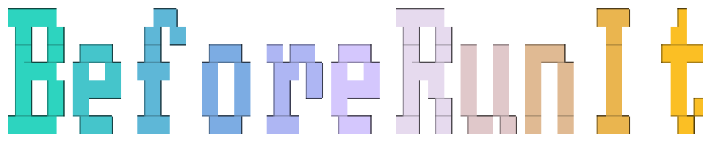

<p align="center">
  
</p>

<h3 align="center">Your finger is on Enter. Read the line under it first.</h3>

<p align="center">
  BeforeRunIt reads the command you are typing and tells you, in plain English,<br>
  what it will actually do. One line under your prompt. About ten words.<br>
  A rule book answers instantly. An AI you choose answers the rest.
</p>

<p align="center">
  <a href="#install"></a>
  <a href="#an-ai-that-knows-the-commands-the-rule-book-does-not"></a>
  
  
  <a href="#license"></a>
</p>

## The half-second that matters

The dangerous command and the safe one are often the same letters.

```text
$ rm -rf build/
╰─  DANGER  Deletes "build/" forever. Skips Trash.

$ rm -rf build /
╰─  DANGER  Deletes your entire system. Unrecoverable.
```

One space. That is the difference between a folder and your whole machine. The man page explains it too, but not in the moment your finger is already moving. BeforeRunIt does.

Same idea, other shapes:

```text
$ curl https://example.com/install.sh | sh
╰─  DANGER  Runs an internet script without checking it.

$ git push --force origin main
╰─  DANGER  Overwrites remote history of "main". Others lose work.

$ git status
╰─  KNOWN  Runs git status.

$ ncdu
╰─  UNKNOWN  Not in the rule book. Check before running.
```

`git status` only looks. `ncdu` is a real, useful program that the rule book has simply not met yet, so the line says so instead of pretending.

That last line is where the AI comes in.

## An AI that knows the commands the rule book does not

The rule book knows about 160 common commands by heart. Linux has thousands.
Turn on the AI review and the UNKNOWN line stops being a shrug:

```text
$ ncdu
╰─  UNKNOWN  Not in the rule book. Check before running.
        ...you pause for a moment...
╰─  KNOWN  Shows which folders use the most disk space  AI

$ frobnicate --all
╰─  CAUTION  Unknown program, check what it does first  AI
```

The **AI** at the end is a small robot icon in your terminal. It tells you
the AI wrote that line, not the rule book.

It is a second opinion, not a replacement. The two work together:

| | Rule book | AI review |
|---|---|---|
| Speed | Instantly, on every key | A moment after you stop typing |
| Knows | ~160 common commands, exactly | Almost anything, from its training |
| Needs | Nothing. Works offline | A model: free on your own machine, or an API key |
| Gets the final say on | Hard rules, always | Everything else, within limits |

**It can warn you, but it cannot talk you into danger.** The AI may raise a
warning whenever it disagrees. It may lower one by a single step, and only
when it is very sure. It can never lower a hard rule. Here is
`beforerunit explain`, showing its work:

```text
$ dd if=/dev/zero of=/dev/sdb
╰─  DANGER  Overwrites disk "/dev/sdb". All data lost.  AI
   Command   dd
   Rules     DANGER  hard rule, AI cannot lower it
   Targets   /dev/sdb
   AI        DANGER 0.95  Overwrites the whole disk sdb. No undo.
```

**It looks at where you are, not just what you typed.** The AI is told the
folder name, whether it is a git repo with uncommitted changes, whether you are
root, and whether the files you named exist. "Delete build" means something
different when `build` is the only copy of your work.

**It never slows your typing.** Every keystroke is answered by the rule book
first. The AI only runs once you pause, in a small background helper. Its
answer slides into the same line, and repeat commands come from a cache
instantly.

**It is your AI.** Run it free and fully offline with
[Ollama](https://ollama.com) or LM Studio, or use Groq, OpenRouter, OpenAI, or
any server that speaks the OpenAI API. Turning it on takes a minute:
[see how](#turn-on-the-ai-in-a-minute).

## The four words

Every command gets one of these. That is the whole idea.

<table>
<tr>
<td align="center" width="25%">
<br>
<b>KNOWN</b><br>
Safe. This one only looks, or it is harmless.
</td>
<td align="center" width="25%">
<br>
<b>CAUTION</b><br>
Slow down. This changes something, but you can usually undo it.
</td>
<td align="center" width="25%">
<br>
<b>DANGER</b><br>
Stop. This can delete files, break a system, or throw work away.
</td>
<td align="center" width="25%">
<br>
<b>UNKNOWN</b><br>
Not in the rule book yet. Read it yourself before you run it.
</td>
</tr>
</table>

## What that looks like

<table>
<tr>
<td align="center" width="50%">
<br>
<b>DANGER.</b> The line spoke before Enter did.
</td>
<td align="center" width="50%">
<br>
<b>KNOWN.</b> All good. Carry on.
</td>
</tr>
<tr>
<td align="center">
<br>
<b>UNKNOWN.</b> Never seen this command. Check it first.
</td>
<td align="center">
<br>
<b>Turn on the AI.</b> Now UNKNOWN gets a real answer.
</td>
</tr>
</table>

The pictures are the mascot. The lines above are exactly what your terminal prints, and they update on every key.

## Install

One command. It works for a normal user, with no root password:

```sh
curl -fsSL https://github.com/vishwathilina/BeforeRunIt/releases/latest/download/install.sh | sh
```

Then open a **new** terminal and type `ls`. The line should show up underneath.

Already cloned this repository? Run `./install.sh` from the project folder.
It installs the copy you built (and builds it first, if you have not).

The installer puts three things in place:

- `beforerunit`, the program, in `~/.local/bin` (or `/usr/local/bin` if you are root)
- `bri`, a shorter name for the same program
- one line in the startup file of your login shell, so it loads every time

If `~/.local/bin` is not on your `PATH`, the installer says so. The line under
your prompt still works. Add that folder to your `PATH` when you want to type
`beforerunit` yourself.

### Add the line yourself

Only needed when you installed with `--no-modify-rc`, or the installer could
not see your shell.

| Shell | Add this line to | |
|---|---|---|
| bash | `~/.bashrc` | `eval "$(beforerunit init bash)"` |
| zsh | `~/.zshrc` | `eval "$(beforerunit init zsh)"` |
| fish | `~/.config/fish/config.fish` | `beforerunit init fish \| source` |

Using [ble.sh](https://github.com/akinomyoga/ble.sh)? Put the bash line
**before** `ble-attach`.

Other installs: `.deb` and `.rpm` from the
[releases](https://github.com/vishwathilina/BeforeRunIt/releases),
[`packaging/aur/PKGBUILD`](packaging/aur/PKGBUILD) for Arch, or
`nix profile install github:vishwathilina/BeforeRunIt`.

### Check that it worked

```sh
beforerunit doctor
```

Green marks are fine. A yellow mark comes with the exact command to fix it.

### The icons look like empty boxes

The badges use a [Nerd Font](https://www.nerdfonts.com). If you see boxes
instead of small icons:

```sh
beforerunit fonts install
```

That downloads Maple Mono and tells you where to select it in your terminal.
You can also skip the icons: in `beforerunit setup`, set icons to `unicode`
or `ascii` and the badges become plain text.

## Day to day

Just type. The line follows along. Pressing Enter clears it, then your
command runs as usual.

- **Alt-B** hides the line. Press it again to bring it back.
- `beforerunit explain rm -rf build` prints the full reason, not just the ten words.
- `beforerunit setup` opens the settings screen: colors, when to show the line, and the AI.
- In that screen, **Ctrl-S saves**. Closing it with `q` throws the changes away.

| Command | What it does |
|---|---|
| `beforerunit setup` | Settings: colors, the AI, and the rule book |
| `beforerunit explain CMD` | The full reason for one command |
| `beforerunit doctor` | Checks that the shell, the font and the AI are set up |
| `beforerunit test-ai` | Sends one sample command to your AI, to prove the key works |
| `beforerunit fonts install` | Downloads a font that can draw the icons |
| `beforerunit uninstall` | Removes the shell line, the settings and the font |

`explain` uses its exit code so scripts can read it: 0 known, 1 unknown,
2 caution, 3 danger.

## Turn on the AI in a minute

The AI is optional. Nothing is sent anywhere until you set it up, and
everything else in BeforeRunIt works without it.

**Free and offline, on your own machine.** Install [Ollama](https://ollama.com), then:

```sh
ollama pull qwen2.5:0.5b
beforerunit setup
```

On the Provider row, press the right arrow until it says **Ollama (local)**.
That fills in the address and the model for you. Press `t` to test, then
**Ctrl-S** to save.

**Or a hosted model.** In `beforerunit setup`, pick Groq, OpenRouter or
Custom (for OpenAI or your own server), paste your API key, press `f` to fetch
the model list, `t` to test, and **Ctrl-S** to save.

Open a new terminal afterwards. `beforerunit test-ai` checks the connection
from the command line at any time.

Pick a small, fast instruct model. Reasoning models spend the whole reply
"thinking" and often send back nothing useful.

**Choose how often it speaks up** with `mode` in the settings:

| Mode | What the AI reviews |
|---|---|
| `review-all` | Every command, as a second opinion on the rule book too. The default. |
| `unknown-only` | Only commands the rule book does not know. Fewer requests. |
| `off` | Nothing. Rule book only, no network at all |

**What it sees, and what it never sees.** The AI gets the command, with
passwords, tokens and keys blanked out first. It also gets the folder name,
the git state, whether you are root, and whether the files you named exist.
It never gets your file contents, your environment variables, or your history.

Your key is stored in the system keyring. With no keyring, it goes in a file
only your user can read. `BEFORERUNIT_API_KEY` overrides both. Answers are
cached for 7 days, so a command you repeat in the same folder is asked about
once, not every time.

## Support this project

BeforeRunIt is free, open source, and built in spare time. If it has ever
stopped you pressing Enter on the wrong command, you can help keep it going.

<table>
<tr>
<td width="180">

</td>
<td>
<a href="https://buymeacoffee.com/vishwathilina"></a>
<br><br>
One coffee goes a long way. Thank you.
</td>
</tr>
</table>

## Settings

`beforerunit setup` writes this file for you. It lives at
`~/.config/beforerunit/config.toml`. Here it is with the Ollama provider picked:

```toml
[ai]
mode = "review-all"            # review-all, unknown-only, or off
provider = "ollama"
base_url = "http://localhost:11434/v1"
model = "qwen2.5:0.5b"
timeout_ms = 4000
debounce_ms = 300

[ui]
display = "always"             # always, risky-only, or off
theme = "midnight"             # midnight, nord, catppuccin, gruvbox, contrast, mono
icons = "nerd"                 # nerd, unicode, or ascii
reduce_motion = false
screen_reader = false          # plain text, no animation, easy to hear
toggle_key = "\\eb"            # Alt-B
```

`risky-only` hides the line for KNOWN commands, so it only speaks up when
something needs a look. `screen_reader = true` prints `[DANGER] ...` as
ordinary text. `NO_COLOR` is respected.

### Your own rules

Any command can be taught. Drop a file in `~/.config/beforerunit/rules.d/`
and open a new terminal (or run `beforerunit compile`):

```toml
[[cmd]]
name = "deploy"
risk = "caution"
text = "Deploys {target} to production."

  [[cmd.rule]]
  flags_any = ["force", "f"]
  risk = "danger"
  text = "Force-deploys, skipping checks."
```

`text` is what the line will say, in plain words, ten words at most. The
built-in rules in [`rules/`](rules) are full of examples.

## For the curious

The line has to keep up with your typing, so there are hard speed limits.
`beforerunit bench` checks them on your machine.

| What | Must stay under | Usually |
|---|---|---|
| Deciding the risk for one keystroke | 50 µs | 3 µs |
| bash, keystroke until the line is drawn | 6 ms | 0.9 ms |
| zsh, same | 6 ms | 2 ms |
| fish, same | 12 ms | 4 ms |
| Time added when the shell starts | 5 ms | 3.8 ms |
| Memory while idle | 15 MB | 9 MB |
| Program size | 8 MB | 7.2 MB |

bash runs the check inside the shell itself, so it does not start a new
program on every key. zsh keeps one connection open to a small background
helper. fish starts one small program per keystroke. The helper starts on its
own the first time the AI is needed, and it exits after a few idle hours.

The code is split into `beforerunit-core` (the rules and the line),
`beforerunit-ai` (the AI client), `beforerunit-bash` (the in-shell piece)
and `beforerunit` (the program you run).

## Contributing

Rule ideas are the best place to start. See
[CONTRIBUTING.md](CONTRIBUTING.md). Security issues go through
[SECURITY.md](SECURITY.md), not the public issues.

## License

[MIT](LICENSE-MIT) or [Apache-2.0](LICENSE-APACHE), whichever you prefer.
